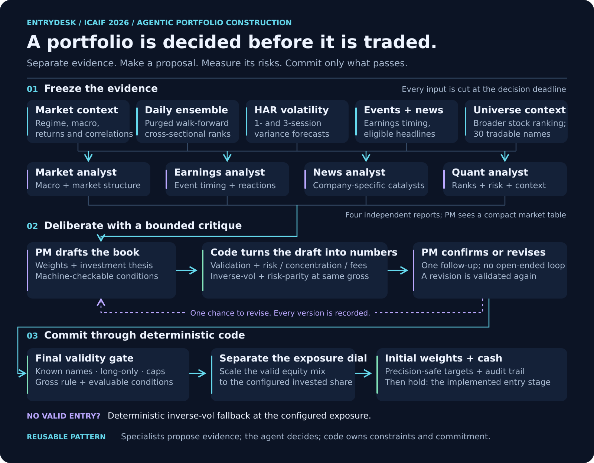

# How initial weights become a committed portfolio



The figure describes the implemented reports-only `V3Desk` configuration. The core design is not a free-running agent with brokerage tools. It is a bounded decision protocol around structured model outputs and deterministic portfolio code.

## 1. Freeze the evidence

`V3Desk._decide` builds a point-in-time observation from data available by the round deadline. `strip()` removes disabled streams before any role sees them, including copies of entry-time fields, so an ablation cannot leak a removed stream through another part of the payload.

The selected entry runs four analyst roles in parallel, each restricted to its own view:

| Analyst | Input view |
|:--|:--|
| Market | Market/regime readings and macro context |
| Earnings | Reporting schedule and available historical event reactions |
| News | Eligible headlines; filing context only when that stream is enabled |
| Quant | Numerical per-stock evidence, volatility context, model ranks, and broader-universe ranking |

A role with no relevant event/headline input is represented as such; the system does not invent a report. The official runner's selected streams omit SEC filings. The diagram shows that selected evidence set, while the core code supports other configurations.

## 2. Compress expertise before allocating

In `reports_only` mode, `_pm_view` gives the PM analyst reports plus the clock, book state, gross-exposure rule, a small market table, and basic per-name fields. It does not append every raw feed again. Alternative `none` and `reports_raw` configurations are available for experiments.

The PM produces a typed `PMEntry`:

```text
weights       explicit names and amounts; absent names are not bought
thesis        why this portfolio is the selected allocation
conditions    bounded, machine-checkable conditions attached to the plan
```

The allowed condition vocabulary includes price moves, drawdowns, earnings gaps, give-back from peak, volatility ratios, and selected filing events. The validator checks name scope, threshold requirements, action compatibility, and whether referenced names are actually held. These conditions describe a plan; stage 1 records them without executing later changes.

## 3. Validate the proposal and quantify its risks

`_judge` refuses the entire draft when it breaks the universe, duplicates a name, violates precision or gross rules, exceeds a per-name cap, or contains an unevaluable condition. Fixed-sleeve mode has its own explicit normalization rule; it is not a general-purpose repair of arbitrary invalid weights.

For a valid draft, `selfcheck.report` produces a deterministic report:

- gross, cash, number held, largest weights, and effective number of names;
- expected volatility and diversification from shrunk historical covariance;
- market-basket beta;
- weight reporting earnings inside the calendar horizon;
- recent hypothetical drawdown, with its approximation stated;
- entry turnover and estimated fee;
- inverse-volatility and risk-parity references **at the draft's gross**.

The self-check does not read HAR or daily-model scores. That is deliberate: removing a stream in an experiment must not secretly restore it through the critique. A return-chasing historical-performance headline is also excluded from the risk report.

A refused draft can still reach the follow-up, carrying every refusal reason rather than invented risk statistics for an invalid book.

## 4. One chance to reconsider

The PM receives its draft and code's report and returns a typed `PMCheck`: either `confirm` or `revise` with a complete replacement entry. There is one follow-up, not an unlimited tool-use loop.

A valid revision replaces the draft and gets another recorded risk report, but no third PM call. If a revision fails while the original draft was valid, the original usable draft remains available. If no valid entry survives, the desk takes the deterministic inverse-volatility fallback. Failures and fallback reasons are counted.

## 5. Separate composition from exposure

The PM decides a relative stock allocation. When configured, code then applies an exposure overlay:

```text
NAV weight_i = (PM weight_i / sum(PM weights)) × overlay
cash target  = 1 − sum(NAV weights)
```

An all-cash entry is handled separately. Weights pass through the precision-safe conversion and the execution path. The actual simulator cash balance also reflects transaction fees; the cash target above is the allocation identity before those fees.

The recorded official entry used `overlay=0.001`: 0.1% invested. A 12% NVDA share of the equity mix therefore corresponds to 0.012% of NAV. Earlier research explored other exposure choices. The official PM was not told the post-decision overlay, so the final record preserves its proposed gross separately from executed gross.

## 6. Keep the evidence trail

`V3Desk.entry` records the draft, validation errors, self-check, PM response, revised report when applicable, final selection, source/fallback reason, and target weights. `state()` and `restore()` persist the entry and plan. This supports inspection of the decision rather than only inspection of the eventual P&L.

The implemented strategy then holds the initial book. A later analyst/associate/PM escalation chain is a design proposal in `v3_desk_plan.md`, not an implemented stage-2 feature.

## Adapting the pattern

The transferable unit is the protocol, not the stock vocabulary:

| Trading implementation | A different allocation problem |
|:--|:--|
| Market/news/earnings/quant specialists | Domain specialists with restricted evidence views |
| Stock weights | Proposed resource allocation |
| Covariance, concentration, fees | Deterministic cost, capacity, uncertainty, or feasibility checks |
| Gross/per-name caps | Domain constraints |
| Confirm or revise once | Bounded critique and decision |
| Inverse-volatility fallback | A domain-appropriate deterministic baseline |
| Recorded entry artifact | An auditable decision record |

To reuse it, replace evidence adapters, schemas, quantitative diagnostics, validation rules, and fallback together. Preserve the split between what a model proposes and what code can authorize. Domain-specific constraints and evidence need their own validation; this repository does not establish performance outside its trading setting.
