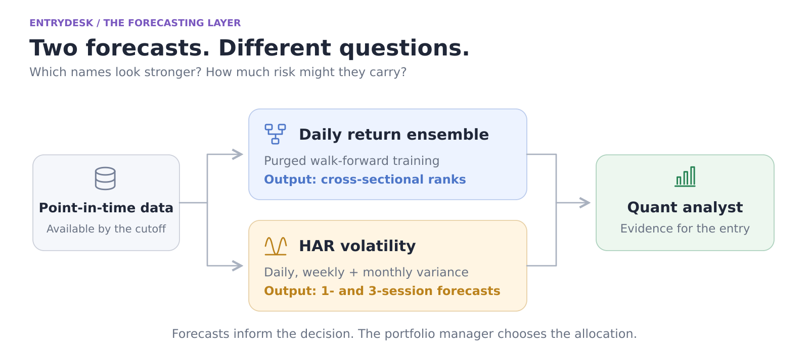

# Forecasts inform the entry; they are not the entry policy

## Daily return-ranking ensemble

`icaif/train.py` orchestrates AutoGluon ensembles; `daily_features.py`, `features.py`, and `labels.py` construct features and forward targets. The daily model ranks stocks on multi-session forward returns. Its broader training universe provides context; only the 30 competition names can be traded.

The evaluation addresses two common leakage paths:

1. **Across yearly folds:** training rows must have labels that end before the test period, not just decision dates before it.
2. **Inside stacking/bagging:** contiguous inner blocks group all rows of a decision, and label paths crossing a block boundary are excluded. Random folds alone would leave neighboring rows with substantially overlapping return paths.

The primary diagnostic is out-of-sample cross-sectional rank IC, including re-ranking within the contest universe. It is not a claimed trading return. `icaif/agents/signals.py` serves the relevant day's model ranks; a future day's prediction is not silently substituted.

AutoGluon's configured model families and any resulting trained stack depend on the actual run. This repository includes training code, not the trained prediction artifacts. See `tools/train_walkforward.py` and the historical daily-model sections in `development-notes.md`.

## HAR realized-volatility forecasts

`icaif/vol.py` builds realized variance from intraday returns plus the overnight gap. Invalid/incomplete sessions remain missing rather than appearing artificially calm.

The log-HAR regressors summarize realized variance at daily, five-session, and 22-session scales. Targets cover the next one and three sessions. Stocks use a pooled fit and the market basket uses a separate fit. Quarterly walk-forward training includes only targets whose full horizon has ended. A Duan-style smearing factor converts log forecasts back to variance without assuming Gaussian residuals.

The implementation explicitly handles gaps in lag features, minimum window coverage, half-days, and the distinction between variance and annualized volatility. Those details are part of the forecaster, not data-cleaning footnotes. Unpredictable jumps and earnings surprises remain limitations.

`icaif/agents/signals.py` provides point-in-time forecast lookups for replays. Live inference is separated from the historical walk-forward path and tested for parity where inputs coincide.

## The deterministic entry critique is separate

HAR forecasts and daily ranks can inform the specialists, but `icaif/agents/selfcheck.py` computes the draft's risk critique from historical closes and shrunk covariance. It does not secretly put an ablated forecasting stream back into the PM's view.

Other context includes regime filtering, OU residual scores, risk parity, inverse volatility, and—in earlier desks—Black–Litterman views. The v3 PM chooses a free book from its reports; it is not merely a wrapper around the earlier rule desk's allocation recipe.

## Reproduction limits

The full forecasting environment is in `requirements.txt` and is heavier than the offline demo. Model training, data collection, historical feed availability, licenses, time cutoffs, and original artifacts all matter. Historical replay performance is conditional on the chosen windows, modeled competitor field, execution assumptions, and model knowledge cutoff. It should not be presented as the final contest leaderboard or as validated future performance.
